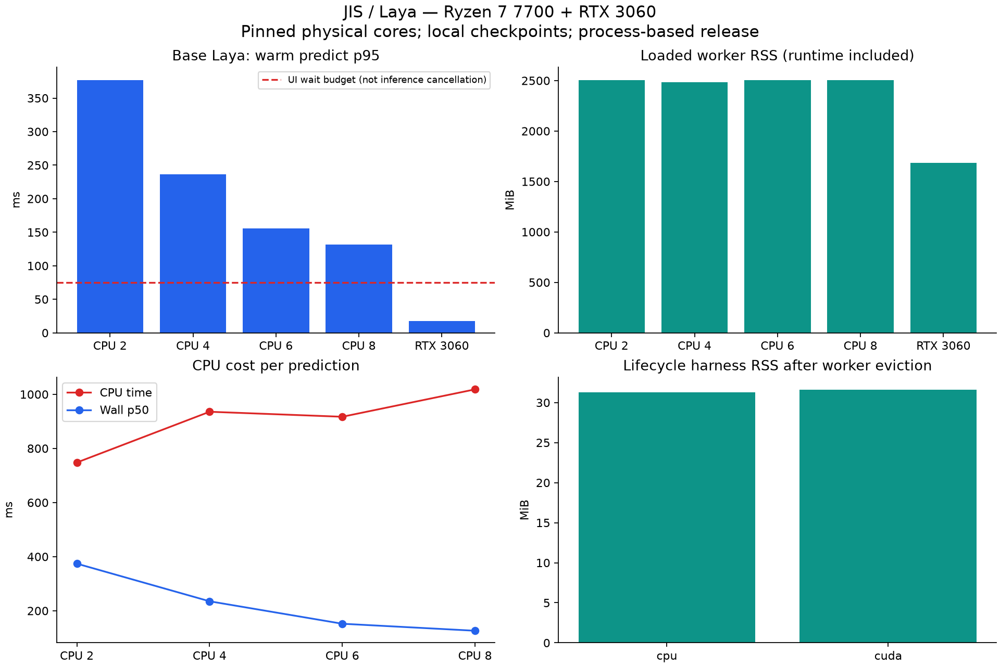

# JIS/Laya: checkpoint thật và adaptive lifecycle — 2026-10-11

Máy Ryzen 7 7700, 8 core vật lý / 16 logical; RTX 3060 12 GiB; `bqp`
Python 3.12.14, torch 2.14.0+cu130, transformers 5.17.0, laya **0.4.0**
đã có sẵn. Không cài/nâng cấp dependency. Hai checkpoint 421.293.827 tham số,
khoảng 842,6 MB mỗi safetensors. Base revision và typed revision/SHA256 ở
[manifest base](laya-base-manifest.json), [manifest typed](laya-typed-manifest.json).

| Model / cấu hình | Warm inference p50 / p95 (ms) | RSS / peak RSS (MiB) | VRAM process (MiB) | Nạp + warmup (s) | Raw eligible đúng |
|---|---:|---:|---:|---:|---:|---:|
| base / cpu 2 | 374.14 / 377.02 | 2506 / 3247 | — | 4.38 | 7/7 |
| base / cpu 4 | 235.07 / 236.31 | 2482 / 3243 | — | 4.10 | 7/7 |
| base / cpu 6 | 152.08 / 155.94 | 2504 / 3243 | — | 6.11 | 7/7 |
| base / cpu 8 | 126.20 / 131.32 | 2506 / 3243 | — | 3.86 | 7/7 |
| base / cuda 2 | 16.88 / 17.43 | 1686 / 3324 | 2632.0 | 6.30 | 7/7 |
| typed / cpu 2 | 369.69 / 372.92 | 2513 / 3254 | — | 4.23 | 7/7 |
| typed / cuda 2 | 16.81 / 17.80 | 1693 / 3330 | 2632.0 | 4.85 | 7/7 |

Mỗi hàng là process mới, chạy tuần tự; CPU ghim một logical CPU/core vật lý
(ID 0..1/3/5/7), torch math threads bằng số core, interop=1, tokenizer không
parallel. CUDA host dùng 2 core, autocast **fp16**; CPU F32. Eager, compile/
TileLang tắt, nice +10. 40 request warm cùng schema; thời gian đo toàn bộ
`Agent.predict` trong worker, có tokenize, serialize, decode và copy output
GPU về CPU (đồng bộ). Không bao gồm socket RPC/zsh/terminal emulator.
RAM là cả process/runtime; peak gồm loading. VRAM từ nvidia-smi đúng PID.
CPU/GPU khác precision; không coi đây là so sánh số học tương đương.



## Case và giới hạn chất lượng

30 case cố định ở `tests/decision_cases.json`. 23 case bị policy/provider
loại hoặc chỉ có một ứng viên, nên runtime không gọi model. 7 case có >=2
ứng viên được gửi model, cả base và typed đúng 7/7 trên tất cả cấu hình;
pipeline assist khớp expected 30/30 trong bộ nhỏ này. Bộ test có chọn lọc,
không phải benchmark độc lập hoặc độ chính xác sản phẩm. Không so trực tiếp
7/7 với Reflex 12/19 trước đây: diagnostic Reflex cũ cũng gọi model cho case
có một ứng viên; điều kiện eligibility/schema/runtime khác.

Không thấy typed tốt hơn base trên những case này. Typed được fine-tune cho
bốn nghiệp vụ khác, chưa phải terminal; base làm mặc định, typed vẫn chọn
được qua `JIS_LAYA_CHECKPOINT` / CLI. Không dùng Router preload ba model vì
trái mục tiêu một worker/tài nguyên thấp. Cả hai là checkpoint English.

Bốn case thêm có spelling tie ở `tests/laya_ambiguity_cases.json` dùng ý định
expected **synthetic**, không khẳng định biết chắc ý định người dùng. Ví dụ
`git pulh origin HEAD` với previous `git commit -m update` đặt intended là
`git push origin HEAD`, nhưng model chọn `git pull origin HEAD` với max-prob
confidence khoảng 0,92. Confidence cao vẫn có thể khác ý định; không tuyên bố
Laya cải thiện mọi lỗi. Gợi ý vẫn chỉ điền sau xác nhận, người dùng có thể sửa.

## Thu hồi/nạp lại thật

Chương trình kiểm chứng dùng ResourceProbe thật để nạp. Sau đó inject
snapshot MemAvailable=100 MiB để đi qua đúng nhánh low-memory policy;
**không làm cạn RAM thật**. Worker CPU/CUDA được terminate/reap, PID không
còn trong `/proc`, rồi nạp lại PID mới sau cooldown. Chờ idle thật 5s cũng
thu hồi worker. Test dùng idle=5s/cooldown=1s để ngắn; sản phẩm 120s/30s.

- cpu: parent trước nạp 30.59 MiB; worker khi nạp 2474 MiB; parent sau thu hồi 31.30 MiB. First rank 75.28 ms, cache hit, reload và idle release đều được xác nhận.
- cuda: parent trước nạp 31.53 MiB; worker khi nạp 1628 MiB; parent sau thu hồi 31.58 MiB. First rank 42.09 ms, cache hit, reload và idle release đều được xác nhận.

Đây là RSS của **chương trình kiểm chứng lifecycle** và worker, không thay
thế số đo daemon dưới tải lớn. GPU context được sở hữu bởi worker đã thoát;
không gọi `del` rồi giữ process torch trong RAM. Cache parent vẫn có tối đa
32 kết quả, TTL 30s, ràng buộc session/ngữ cảnh. Cache hit không thêm inference.

CPU 2 core ~377ms vượt ngân sách Enter 75ms, nên lần đầu fallback rồi cache
kết quả muộn; GPU ~17ms có thể đáp ứng khi đã nạp. Request khi cold/loading/
bận/thiếu tài nguyên vẫn trả heuristic; không làm terminal chờ model nạp.
Đường history suggestion không dùng model. Thêm terminal không thêm worker.
Unloaded daemon không import ML libraries và không probe GPU khi không có demand.

Ngưỡng hiện tại: nạp RAM >=6 GiB, CPU <=70%, PSI <=1%; auto ưu tiên GPU khi
VRAM >=4 GiB và utilization <70%, ổn định 3 mẫu. Thu hồi RAM <1 GiB / PSI >5%
/ VRAM <768 MiB; CPU >92% / GPU >95% kéo dài 3 mẫu; cooldown 30s. Snapshot
không reserve tài nguyên: OOM/driver/kernel vẫn là rủi ro được ghi trong audit.

Không đo watt/joule; CPU-seconds nằm trong JSON. Nhiều core giảm wall latency
nhưng tăng CPU cost. Không nội suy sang máy yếu; cơ chế admission có thể giữ
heuristic toàn bộ phiên trên máy ít RAM. Trước khi tin quyết định model cần
tập terminal độc lập, calibration và kiểm chứng false-positive/abstention.

Tái lập trong `conda activate bqp`:

```zsh
python scripts/fetch_laya.py
python scripts/benchmark_laya.py
python scripts/verify_laya_lifecycle.py
python scripts/report_laya.py
PYTHONPATH=src python -m unittest discover -s tests -v
JIS_MODEL_TEST=cpu PYTHONPATH=src python tests/integration_zsh.py
JIS_MODEL_TEST=cuda PYTHONPATH=src python tests/integration_zsh.py
```

[JSON đo đầy đủ](laya-benchmark.json), [lifecycle/ambiguity JSON](laya-lifecycle.json),
[bảo mật/rủi ro](security-review.md), [test summary](verification-model.md).
Primary model cards: [base](https://huggingface.co/convaiinnovations/laya),
[typed](https://huggingface.co/convaiinnovations/laya-typed-decisions).
