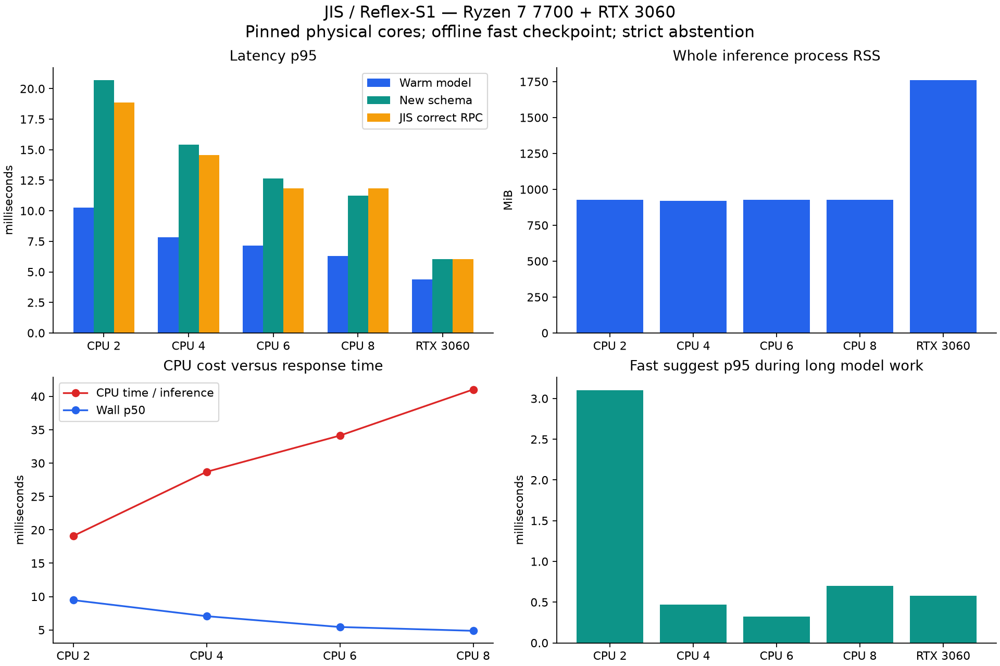

> Báo cáo lịch sử của phiên bản dùng Reflex-S1; runtime và script Reflex đã được loại bỏ. Xem laya-results.md cho phiên bản hiện tại. Bộ case nay ở tests/decision_cases.json.

# Đo Reflex-S1 trên JIS — 2026-10-11

Máy: AMD Ryzen 7 7700, 8 core vật lý / 16 logical CPU; NVIDIA RTX 3060 12 GiB;
Python 3.12.14 trong `conda activate bqp`, torch 2.14.0+cu130.
Checkpoint fast safetensors 23.242.121 tham số, khoảng 93 MB.

Mỗi cấu hình chạy trong process mới, ghim affinity vào một logical CPU của
mỗi core vật lý: CPU 2/4/6/8 dùng lần lượt các CPU ID 0..1/3/5/7; CUDA dùng
2 core CPU cho host. Số thread torch bằng số core cấp, interop=1, tokenizer
parallelism tắt. CUDA được synchronize trước/sau phép đo inference.

| Cấu hình | Inference warm p50 / p95 (ms) | Schema mới p95 (ms) | Correct RPC p95 (ms) | RAM process inference (MiB) | VRAM process (MiB) |
|---|---:|---:|---:|---:|---:|
| CPU 2 | 9.47 / 10.25 | 20.70 | 18.85 | 926 | — |
| CPU 4 | 7.06 / 7.85 | 15.43 | 14.56 | 922 | — |
| CPU 6 | 5.44 / 7.15 | 12.66 | 11.85 | 927 | — |
| CPU 8 | 4.87 / 6.30 | 11.26 | 11.82 | 926 | — |
| RTX 3060 | 3.20 / 4.37 | 6.05 | 6.03 | 1761 | 244 |

RAM là RSS của cả process Python/runtime/model sau bộ đo, không chỉ tensor
trọng số; PSS và peak RSS nằm trong JSON. VRAM process lấy từ `nvidia-smi`,
không cộng desktop/ứng dụng khác. Bộ đo CUDA dùng autocast BF16 của upstream,
CPU dùng F32; vì vậy không xem đây là phép so sánh số học hoàn toàn tương đương.

`warm` dùng cùng schema đã cache, 80 lần đo. `schema mới` đổi criteria mỗi
lần, 24 lần đo, không cache. RPC đo 40 truy vấn `git statsu` sau warmup, dùng
JIS thật với filter và strict abstention. Độ trễ RPC có nhiễu lập lịch nên
không nhất thiết giảm đều theo số core. Các process được chạy tuần tự,
không benchmark đồng thời nhiều cấu hình.



## Cold, CPU và nhiều terminal

- **CPU 2**: import torch 715 ms, nạp checkpoint 550 ms, inference đầu 218 ms; daemon ready 3746 ms (gồm warmup). CPU warm trung bình 200% với quy ước 100%=một core; CPU nhàn rỗi tăng 0.00 s trong 2 s. RAM 17/64 client: 930.1/930.2 MiB. Suggest p95 khi model xử lý input dài: 3.10 ms.
- **CPU 4**: import torch 714 ms, nạp checkpoint 561 ms, inference đầu 202 ms; daemon ready 3797 ms (gồm warmup). CPU warm trung bình 400% với quy ước 100%=một core; CPU nhàn rỗi tăng 0.00 s trong 2 s. RAM 17/64 client: 928.2/928.3 MiB. Suggest p95 khi model xử lý input dài: 0.47 ms.
- **CPU 6**: import torch 712 ms, nạp checkpoint 585 ms, inference đầu 387 ms; daemon ready 3821 ms (gồm warmup). CPU warm trung bình 599% với quy ước 100%=một core; CPU nhàn rỗi tăng 0.00 s trong 2 s. RAM 17/64 client: 935.2/935.3 MiB. Suggest p95 khi model xử lý input dài: 0.32 ms.
- **CPU 8**: import torch 703 ms, nạp checkpoint 560 ms, inference đầu 195 ms; daemon ready 3747 ms (gồm warmup). CPU warm trung bình 798% với quy ước 100%=một core; CPU nhàn rỗi tăng 0.00 s trong 2 s. RAM 17/64 client: 937.4/937.5 MiB. Suggest p95 khi model xử lý input dài: 0.70 ms.
- **RTX 3060**: import torch 694 ms, nạp checkpoint 808 ms, inference đầu 355 ms; daemon ready 4275 ms (gồm warmup). CPU warm trung bình 100% với quy ước 100%=một core; CPU nhàn rỗi tăng 0.00 s trong 2 s. RAM 17/64 client: 1728.8/1728.8 MiB. Suggest p95 khi model xử lý input dài: 0.58 ms.

CUDA tensor allocation 96.8 MiB, peak 98.8 MiB; reserved 106.0 MiB. Phần VRAM process còn lại chủ yếu là runtime/context.

Idle CPU được lấy bằng `/proc/PID/stat`, độ phân giải 10 ms trên máy này;
`0.00 s` là không thấy tăng ở độ phân giải đó. Không đo điện năng hoặc joule.
Tăng core giảm wall latency nhưng CPU-seconds mỗi inference tăng, nên tốc độ
không đồng nghĩa tiết kiệm tài nguyên. GPU tiêu thụ ít CPU hơn trong mẫu warm
nhưng tăng RAM/VRAM. Không nội suy những số đo này sang máy yếu khác.

Mỗi cấu hình còn chạy 16 client đồng thời × 8 lượt. Chỉ **một** request model
được thực hiện tại một thời điểm; request khác dùng heuristic khi model bận.
Do đó số đo concurrent gồm cả fallback, không phải throughput của 128 lượt
inference đầy đủ. Có một worker nhanh và một worker model, không thêm model
cho từng terminal. RAM tăng ít khi thêm kết nối nhưng model vẫn giữ khoảng
0,9 GiB trên CPU và khoảng 1,7 GiB RAM trên GPU.

## Kết quả case và độ tin cậy

30 case cố định trong `tests/reflex_cases.json`: lỗi executable/subcommand,
đối số có quote, alias hợp lệ, lệnh đúng, lệnh không biết, pipeline/substitution,
secret, ký tự điều khiển, nội dung giống prompt injection và Unicode.
Heuristic khớp expected của cả 30 case. 11 case không có ứng viên hợp lệ nên
không gửi model. Trong 19 case còn lại, lựa chọn thô của model đúng 12/19 trên
cả 5 cấu hình. Đây là một tập diagnostic nhỏ, có chọn lọc; **không** phải độ
chính xác sản phẩm hoặc benchmark độc lập. Với Python/Python3, fixture giữ
đúng tên executable dự định; hai lệnh không luôn tương đương.

Ví dụ lựa chọn thô sai: `gti status` → `gtf status`, `git statsu` → `git stash`,
`pythno app.py` → `python3 app.py`. Nội dung CWD cũng có thể thay đổi lựa chọn,
vì vậy mọi cấu hình dùng cùng CWD `/tmp` và cùng state/criteria cho từng case.
Không kết luận có exploit prompt injection chỉ từ các lựa chọn sai: case
không chứa prompt injection cũng đã có cùng kiểu lỗi.

Cả 19 case đều `abstain=true`: schema terminal chưa được calibrate. JIS giữ
strict abstention nên các lựa chọn thô sai không được đưa vào buffer. Runtime
model hiện chủ yếu thêm chi phí rồi quay về heuristic. Bộ calibration đi
kèm checkpoint dùng hash file `.pt`, khác safetensors, nên upstream cũng
không giữ lại các entry đó khi chỉ nạp safetensors. Không sửa hoặc giả mạo
calibration để ép model chấp nhận. Ngay cả calibration chung của upstream
cũng không xác nhận schema terminal động này.

Input vượt 512 token, schema có description trùng và schema một lựa chọn đều
phát sinh `ValueError`; JIS bắt lỗi model, dùng heuristic và phục hồi cho
request sau. Case nhạy cảm không thực thi lệnh: mọi fixture chỉ là dữ liệu.

## Khuyến nghị từ phép đo

Giữ heuristic làm mặc định cho máy yếu. Profile model dùng CPU 2 thread để
thử tiếp, với state riêng; chưa có bằng chứng tăng chất lượng đủ bù khoảng
0,9 GiB RAM. Bước cần làm trước khi dùng quyết định model là xây tập dữ liệu
terminal và đánh giá/calibrate trên split độc lập, sau đó kiểm tra lại lựa
chọn ứng viên và latency budget. GPU nhanh hơn ở đây nhưng không giải quyết
vấn đề schema/độ chính xác.

Tái lập:

```zsh
source /home/tuanphat/anaconda3/etc/profile.d/conda.sh
conda activate bqp
python scripts/fetch_reflex.py
python scripts/benchmark_reflex.py
python scripts/report_reflex.py
```

Kết quả chi tiết: [JSON](reflex-benchmark.json), [manifest](reflex-manifest.json),
[rà soát bảo mật](security-review.md). Các file `reflex-cpu-*.json` và
`reflex-cuda-2.json` lưu riêng phép đo inference; daemon result nằm trong JSON
tổng hợp. Source và weight revision được ghim trong manifest.
